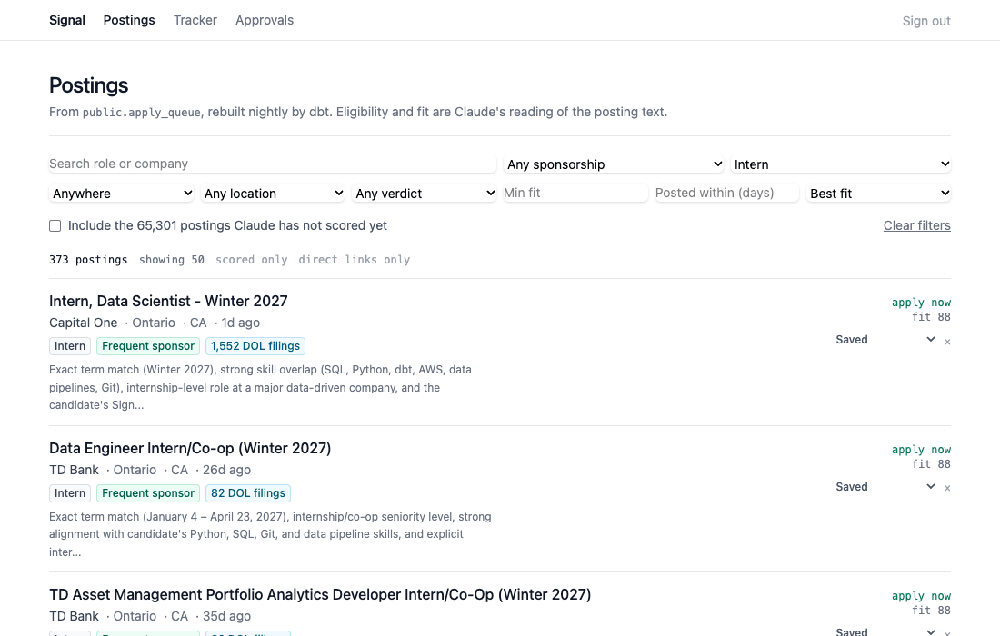
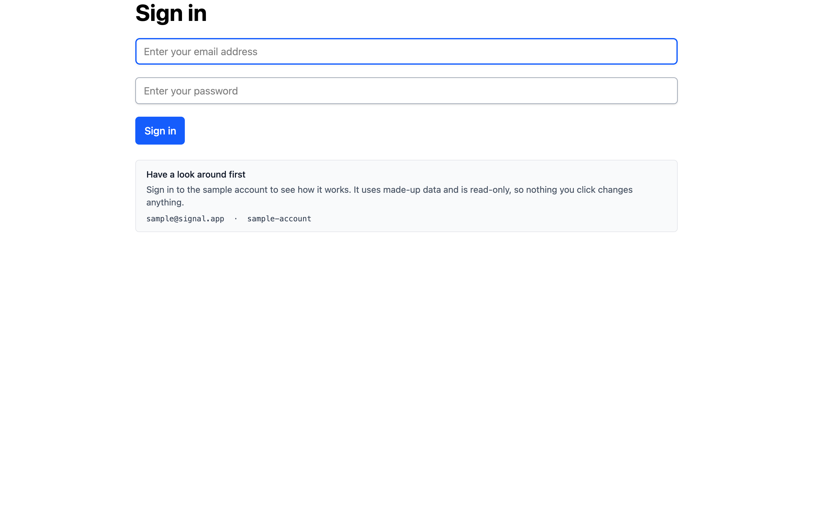
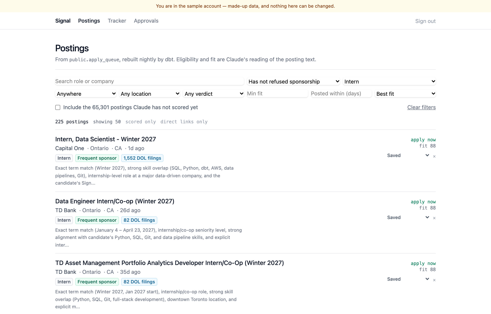
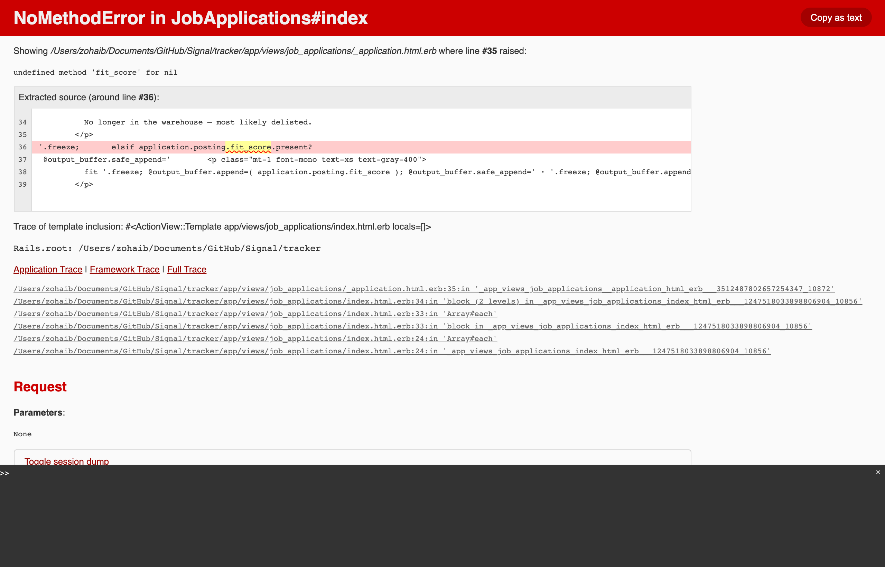
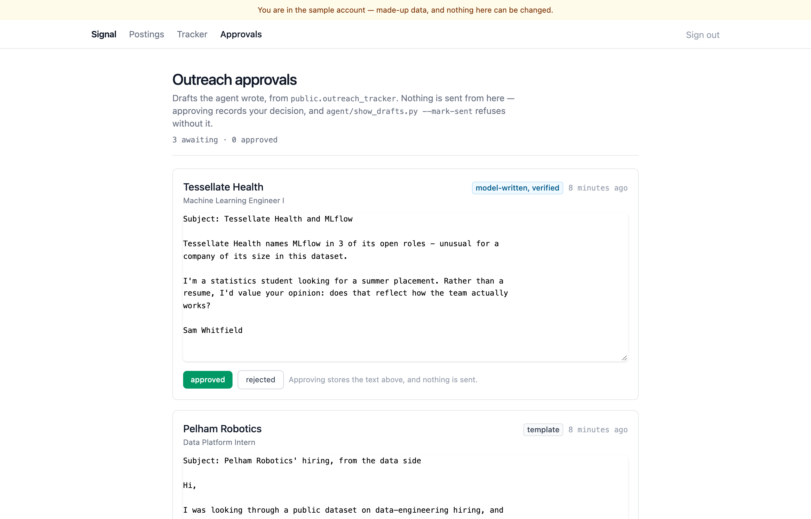

# tracker — the private half of Signal

A single-user Rails app over the same Neon Postgres the Python pipeline fills.
Browse the roles the pipeline scored, track each application, and approve the
outreach agent's drafts before anything can be marked as sent.

It holds one person's real applications and draft emails, so it is password
protected and deliberately not part of the public site.

**Stack:** Ruby 3.4.11 · Rails 8.1.4 · Hotwire (Turbo + Stimulus) · Tailwind ·
RSpec · PostgreSQL (Neon) · deployed free on Render



Browsing the scored postings, narrowing them, saving one, and deciding on a draft.
Nothing reloads: the result list and each row are Turbo Frames.

---

## Have a look around

There is a sample account. Its credentials are on the sign-in page, it holds
invented data, and it is read-only — every non-GET request from it is refused in
`ApplicationController`, before any action runs.

```
sample@signal.app   ·   sample-account
```

It cannot see the owner's tracked roles, notes, approvals, or the real agent
drafts in `public.outreach_tracker`; it reads seeded `DemoDraft` rows instead.
`spec/requests/demo_isolation_spec.rb` proves both halves — what it cannot read
and what it cannot write — and the suite was checked against deliberately broken
scoping to confirm those assertions actually fail when isolation does.

| | |
|---|---|
|  |  |
| Sign in, with the sample account offered | Browse — eight filters, four sorts, results in a Turbo Frame |
|  |  |
| Tracker — roles grouped by stage, notes inline | Approvals — each draft editable before a decision |

Every screenshot above is the sample account, so none of it is real.

---

## What it does

**Browse** — the 71,778 rows of `public.apply_queue` with the eligibility and fit
scores Claude assigned. Search across company and title, filter by country, state,
seniority, recommendation, sponsorship, minimum fit and freshness, sort four ways,
page with "show more".

The default view is the ~500 postings that are both *scored* and *directly
linkable*, not all 71,778. 91% of the table is `not yet scored`, because enrichment
is incremental and costs money, and aggregator links are country-gated and break
outside the posting's own country. Both exclusions are opt-in toggles with their
counts shown rather than silent filters.

**Track** — save a posting, move it through `saved → applied → interviewing →
rejected/offer`, keep dated notes. Status timestamps are stamped once: moving
backwards does not rewrite when a thing first happened.

**Approve** — the agent's drafts, each editable in place, approvable or rejectable.
Nothing is sent from here; `agent/show_drafts.py --mark-sent` refuses without an
approval recorded here.

---

## The part worth reading: Rails cannot write to the warehouse

The pipeline owns the data. This app reads it. That is enforced three times over,
and only the third is beyond the reach of a mistake in this codebase.

```yaml
# config/database.yml — two connections to ONE database
primary:                      # schema `tracker` — Rails owns this
  schema_search_path: "tracker"
warehouse:                    # schema `public` — dbt and Python own this
  schema_search_path: "public"
  replica: true               # ActiveRecord refuses writes
  database_tasks: false       # migrations cannot target it at all
```

1. **`database_tasks: false`** takes the warehouse out of migrations, schema
   management and seeds entirely. A migration cannot touch a dbt relation even by
   accident.
2. **`replica: true`** plus a `readonly?` override on `WarehouseRecord` makes
   ActiveRecord refuse writes before they reach the database.
3. **A `signal_rails` Postgres role** holds `SELECT` on two named tables and no
   `INSERT`, `UPDATE`, `DELETE` or `TRUNCATE` anywhere in `public`. Created by
   `script/setup_database_role.sql`, which mirrors `service/sandbox.py`.

### It is proved, not asserted

```bash
bin/rails runner script/verify_isolation.rb
```

Modelled on `service/sandbox.py`'s `verify()`, it *attempts* the forbidden writes —
`Posting#update!`, `update_all`, raw `INSERT INTO public.outreach_tracker`,
`TRUNCATE`, `CREATE TABLE`, `ALTER TABLE` on a dbt mart — and fails loudly if any
succeeds. It also checks the positive controls, because a script that only proves
writes fail would also pass if the credentials were wrong and nothing worked at all.

Each refusal must come for the **right reason**. An earlier version reported a
check as passing when the write had actually failed on a missing table — a refusal
for the wrong reason is not evidence, and that strictness is what surfaced the
pooler bug below.

---

## Two defects found by building this

### The connection pooler silently swapped the two schemas

Through Neon's default endpoint, `primary` and `warehouse` had separate Rails pools
and separate client objects but reported the **same `pg_backend_pid()`**. PgBouncer
in transaction mode had multiplexed them onto one server backend, where
`search_path` is session state — so whichever connection last ran `SET` won.
`warehouse` began resolving `outreach_tracker` inside `tracker`, where it does not
exist, and `primary` lost `tracker` altogether.

The entire read-only split depends on those two paths differing. Both the app and
its migrations therefore use the **direct** endpoint, and `verify_isolation.rb`
asserts the backend pids differ so a change back fails loudly.

### Every approval read as stale the moment it was made

HTML form submission normalises textarea line breaks to CRLF; the agent writes LF.
So the fingerprint of an *unedited* draft could never match the text in the
database — and the symptom was the staleness banner appearing immediately, which
looks exactly like the check working correctly. The worst kind of bug.

There is now one canonical form (CRLF and bare CR to LF, then strip), implemented
in Ruby and in SQL, and a spec asserts the two produce identical hashes against a
real Postgres.

---

## Approval is a marker, not a status

The obvious design is to add `approved` to `public.outreach_tracker.status`. It
would break three things, and `agent/tools.py:41-49` already specified the correct
shape — *"already at `email_drafted` **AND** carries an explicit human approval
marker"*, a conjunction of two facts:

1. `agent/schemas.py` derives `ALREADY_DRAFTED` by **slicing** `STATUSES`, so
   inserting a value silently changes which statuses block re-drafting.
2. `agent/show_drafts.py` guards on `status = 'email_drafted'` exactly.
3. `draft_is_allowed` rejects anything outside `STATUSES`.

So approval lives in `tracker.outreach_approvals`, keyed `(source, job_id)` and
pinned to a **SHA-256 of the exact text approved**. The agent's upsert uses
`coalesce`, so a draft column keeps old text rather than being cleared — meaning
the agent can change the words under an approval given in good faith. The
fingerprint closes that: a redraft makes the approval recognisably *stale* rather
than silently authorising words nobody read.

`--mark-sent` names which of four things is wrong — no draft, wrong status, never
approved, or approved-then-redrafted — rather than one message for all of them.

---

## Tables it owns

All in schema `tracker`, created by one migration. **No foreign keys to `public`:**
dbt drops `apply_queue` nightly and `prune.py` deletes delisted postings, so an FK
would either block the drop or cascade.

| Table | Purpose |
|---|---|
| `job_applications` | one tracked role, keyed `(source, job_id)` |
| `job_application_notes` | dated notes against one |
| `outreach_approvals` | your decision on one draft, with its fingerprint |
| `users`, `sessions` | the single account |

Company, title and link are **copied in** at save time rather than joined on read:
a posting leaves the warehouse when it is delisted, and a role you applied to in
March must still be readable in June.

Status vocabularies are enforced by a Postgres `CHECK` constraint as well as a
Rails enum — `public.outreach_tracker.status` has no such constraint and keeps its
legal values in a Python tuple, which is the weakness this does not repeat.

---

## Running it

```bash
bin/dev                                      # http://localhost:3000
bin/rails runner script/verify_isolation.rb  # prove the read-only split
bin/rails tracker:backfill DRY_RUN=1         # what it would save from the queue
bin/rails tracker:backfill                   # save the top "apply now" roles
bundle exec rspec                            # 90 examples
bundle exec rubocop && bundle exec brakeman  # style and security
```

First-time setup, once, with warehouse owner credentials:

```bash
psql "$NEON_DIRECT_URL" -v rails_password="'<a strong password>'" \
     -f script/setup_database_role.sql
```

Then put `DATABASE_URL`, `MIGRATE_DATABASE_URL`, `ADMIN_EMAIL` and
`ADMIN_PASSWORD` in `.env` (gitignored) and run `bin/rails db:prepare db:seed`.

**Use Neon's direct endpoint, not `-pooler`.** See the pooler defect above.

---

## Tests

90 RSpec examples, plus 13 pytest tests for the Python send guard — that half is
Python, so testing it in RSpec would only prove Ruby agrees with itself.

`spec/support/warehouse_schema.sql` stands in for the two warehouse relations,
because `apply_queue` is a dbt model and a fresh test database has neither. It runs
`DROP TABLE public.apply_queue`, which pointed at the real warehouse would destroy
a mart — so loading it **refuses** unless the database name ends in `_test` and the
host is local. A spec also asserts every column the app reads exists in the
stand-in, that `outreach_tracker` matches `storage/schema.sql`, and that
`apply_queue` still has no primary key (the model declares the composite one, and a
stand-in *with* a key would make that pass for the wrong reason).

Warehouse rows are seeded in `before(:all)` and committed, because the writer and
the reader are separate Postgres sessions — a `let!` inserts inside the example
transaction and the reader never sees it.

CI runs it all with **no secrets**: its own Postgres, its own schema, stand-ins for
the warehouse.

---

## Deployment

Render free tier, `$0/month` — no database of its own, because the warehouse is
Neon and this app owns one schema inside it.

Migrations run in `bin/render-build.sh` rather than a pre-deploy hook, which is a
paid feature. The build therefore runs before the new version is live, so a failed
migration takes the deploy down instead of leaving a half-migrated app serving
traffic — the right trade for one user.

`WEB_CONCURRENCY=0` (Puma single mode, three threads, three connections). The
connection budget is the reason, not the traffic: a cached connection in this
project once sat idle in transaction for 22 hours and blocked DDL, and
`storage/prune.py` vacuums the same database every morning.

The health check is `/up`, which answers without touching the database, so a Neon
compute that has scaled to zero cannot make Render think the app is unhealthy.

### The free instance sleeps

**It takes about 40 seconds to answer the first request after 15 minutes of
idleness** — measured, not estimated. Render stops a free instance when nothing
has hit it, and Neon suspends its compute on the same sort of schedule, so a cold
visit pays both wake-ups. After that it responds in well under a second until it
goes quiet again.

Removing it is one word: `plan: free` → `plan: starter` in `render.yaml`, which is
**$7/month** and keeps the instance running. Nothing else changes — same build,
same database, same configuration. Neon's own cold start remains, but it is a
second or two rather than forty.

There is no cheaper way to avoid it. Render has nothing between free and starter,
and keeping the instance awake by pinging it burns the 750 free instance-hours a
month that make the free plan free in the first place.

---

## Size

| | |
|---|---|
| Ruby | 3,161 lines across 57 files |
| ERB templates | 613 lines |
| Tables owned | 7, in schema `tracker` (368 kB) |
| Warehouse relations read | 2, read-only |
| Tests | 108 RSpec + 13 pytest |
| Accounts | the owner's, and a read-only sample account |
